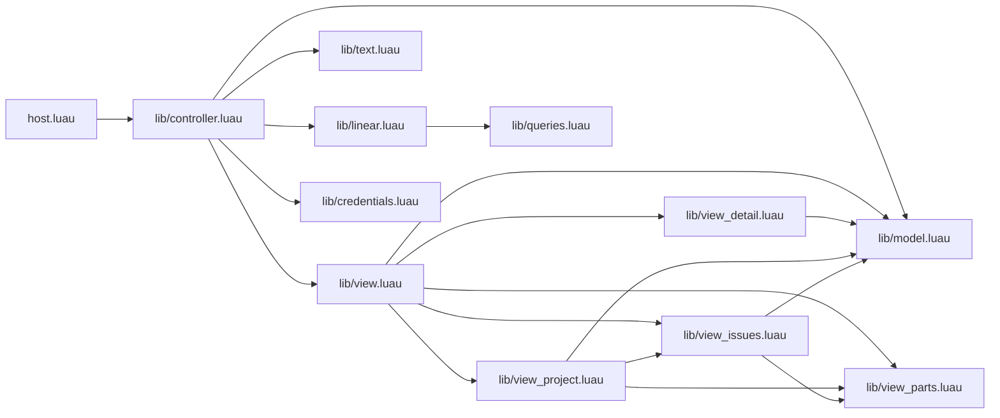

# tern-linear architecture

A pure-Luau Tern plugin. The host half defines one block, `linear.board`, that talks to Linear's GraphQL API with `tern.fetch`. There is no window half, no Node bridge and no background service. Types live in [`lib/types.luau`](../lib/types.luau); this document gives their meaning and the contracts between modules.

The block has two modes (`Prefs.mode`): **projects** (the default) lists the organization's projects; **issues** is the issue board of a team or of the viewer. Both share the top bar, filter row, board and table layouts; each keeps its own data, search text, selection, scope, view and table sort. In projects mode a project opens on a full-screen **project page** (`BlockState.projectPage`) that replaces the list until Back. The page's **Issues** tab shows the project's issues with issues mode's own filter row, board, table and drawer, on data, filters, search, sort and selection of its own.



| File | Owns | Must not |
| --- | --- | --- |
| `host.luau` | `tern.block.define("board", controller.def)` and nothing else | hold logic |
| `lib/types.luau` | shared types | change without updating this doc |
| `lib/queries.luau` | GraphQL document strings, one operation each | build queries dynamically |
| `lib/linear.luau` | HTTP, auth header, error classification, rate headers, paging, normalization into `types.*` | touch block state or `cx` |
| `lib/credentials.luau` | API key resolution, storage, endpoint | log or display the key |
| `lib/model.luau` | pure board logic: grouping, filtering, sorting, server filter, blocked, default states, dates, edit diffs, keyboard navigation; the same for projects (project filter, columns, sort, labels); the Activity timeline (history event descriptions, merging, paging); the Issues tab (its server filter, state-type columns and moves, which list is on screen) | call `tern.*` (pure Luau; unit-tested with the `luau` CLI) |
| `lib/text.luau` | UTF-16 controlled text fields; `safeMarkdown` for descriptions, comments, project documents and project updates | call `tern.*` |
| `lib/controller.luau` | `BlockDef`, state, keys, events, actions, request discipline, polling, forms | build nodes |
| `lib/view.luau` | `main` region, top bar, project filter row, project board and table, setup screen, empty/error states; issues mode's list through `view_issues`; delegates the project page to `view_project`; composes the `layer` from `view_detail` | mutate state |
| `lib/view_issues.luau` | the issue list, one renderer for issues mode and the Issues tab (`IssueList`): priority/assignee/label filter row, board (cards, columns), table and sort bar, empty and loading states | mutate state |
| `lib/view_project.luau` | the project page in `main`: header, tab bar (`model.PROJECT_TABS`), one renderer per tab (`TAB_CONTENT`; Overview, Activity, Issues); the Issues tab's toolbar and search field id | mutate state |
| `lib/view_parts.luau` | node builders and tone tables shared by `view`, `view_issues` and `view_project` (`with`, `compact`, `banner`, `statusDot`, `healthBadge`, `syncedLabel`, view and layout switches, filter row, column, board row, sort bar, loading row, empty states; state/status/health/priority tones) | read state |
| `lib/view_detail.luau` | `layer` region: detail drawer, inline edit form, comments, relations, create dialog; both overlays use the single key `layer.panel` so field ids stay stable | mutate state |
| `styles/linear.css` | styles for `view.luau` and `view_issues.luau` | style `.sf-layer` or unscoped selectors |
| `styles/detail.css` | styles for `view_detail.luau` | style `main` |
| `styles/project.css` | styles for `view_project.luau` (the Issues tab's list uses the `linear.css` roles) | style `.sf-layer` or unscoped selectors |

Every module starts with `--!strict` and requires siblings with `require("./x")` (from `host.luau`: `require("./lib/x")`). Modules return a table of functions; no module keeps mutable globals except `controller.luau`'s run registry and `linear.luau`'s last rate info. `controller.luau`'s top level sits close to Luau's limit of 200 locals per function (the chunk counts as one): new helpers go into an existing table (`parse`, `projectIssues`) or into `model` when they are pure.

## Module APIs

### `lib/queries.luau`

```luau
local queries = {}
queries.Viewer = [[query Viewer { ... }]]
-- Teams, TeamMore, Issues, Issue, IssueCreate, IssueUpdate, CommentCreate,
-- IssueRelationCreate, IssueRelationDelete, IssueLookup, IssuesChanged,
-- ProjectStatuses, Projects, ProjectsChanged, Project, ProjectUpdates, ProjectHistory
return queries
```

Each value is exactly one named operation in a `[[ ... ]]` long string, the operation name equal to the key. `test/validate-queries.mjs` extracts them with the pattern `queries.<Name> = [[<doc>]]` and validates against Linear's SDL. `Teams` uses `$first: Int = 5` (live cost of `first: 10` was 6330 of the 10000 cap).

Project operations and their measured cost (`x-complexity`, `bun run smoke:live`, a 32-project workspace; the cost follows the page size asked for, not the rows returned):

| Operation | Shape | Complexity |
| --- | --- | --- |
| `ProjectStatuses` | `organization { projectStatuses }` (a plain list) | 4 |
| `Projects` | `projects(filter, first: 50, orderBy: updatedAt)`, `teams(first: 5)` per project | 850 |
| `ProjectsChanged` | `projects(filter, first: 1, orderBy: updatedAt) { id updatedAt }` | 2 |
| `Project` | `project(id)`: the list fields plus `content`, `healthUpdatedAt`, `startDateResolution`, `targetDateResolution`, `teams(first: 10)`, `members(first: 50)`, `labels(first: 25)`, `projectMilestones(first: 50)` with `pageInfo { hasNextPage }` | 355 |
| `ProjectUpdates` | `project(id) { projectUpdates(first: 20, after) }`, each with `user` and `comments(first: 10)` | 666 (first 25: 832) |
| `ProjectHistory` | `project(id) { history(first: 25, after, orderBy: updatedAt) { id createdAt updatedAt entries } }` | 89 (first 20: 72) |
| `Issues` (Issues tab) | issues mode's `Issues` with `model.projectIssueFilter` (the project AND the Active view), `first: 50` | 77 (10 issues returned) |
| `IssuesChanged` (Issues tab poll) | the same filter AND `updatedAt > <newest>`, `first: 1` | 3 |

`Project.teams` is capped at 5 in `Projects` because each nested connection multiplies by the page size (5 × 50 rows); the board shows team keys only. `Project` (one project, the project page) affords larger caps. `IssueConnection` has no count, so milestones carry no issue count: it would take a nested `issues` page per milestone. `ProjectUpdates` is dominated by the nested comments (20 updates × 10 comments); `commentCount` still counts all of an update's comments. `Project.comments` (comments on the project overview) is not fetched: none of the 32 projects in the workspace the tab was built against had one, and Linear's own project activity shows updates and history. The Issues tab adds no document: it sends issues mode's `Issues` and `IssuesChanged` with the project filter; measured live for the first project of the unfiltered list (10 Active issues), `Issues` cost 77, unlike the project connections roughly in line with the rows returned.

### `lib/credentials.luau`

```luau
credentials.resolve(): (types.Config?, string?) -- env LINEAR_API_KEY, else the key file; nil + reason when a key exists but LINEAR_API_URL is rejected; nil when neither
credentials.source(): ("env" | "file")?
credentials.save(key: string, cb: (ok: boolean, err: string?) -> ()) -- POSIX: owner-only write via /bin/sh (umask 077, dir 700, file 600); Windows: tern.fs.write
credentials.clear(): (boolean, string?)       -- deletes the key file; false if it is still there; env keys are untouched
credentials.endpoint(): (string?, string?)    -- https://api.linear.app/graphql, or http(s) on 127.0.0.1 / localhost / [::1]; nil + reason when LINEAR_API_URL is anything else
credentials.looksLikeKey(s: string): boolean  -- trimmed, starts with "lin_api_" or "lin_oauth_", no whitespace
```

Key file: `tern.plugin.data .. "/credentials.json"`, JSON `{ "apiKey": "…" }`; reads are capped at 16 KiB and a missing, unreadable or corrupt file counts as "no key". On POSIX, `save` writes through `/bin/sh` with `umask 077` (temp file, then `mv`) and `chmod 700` on the data directory, so the key is never created world-readable and never appears in argv. Windows uses `tern.fs.write`. `clear` removes the file and checks it is gone. That shell is the only process the plugin starts. Personal keys go in `Authorization: <key>` (no `Bearer`); keys starting with `lin_oauth_` get `Bearer `. `tern.secrets` is window-only, so the host half cannot use the keychain. `LINEAR_API_URL` is read only from the daemon environment and is accepted only for Linear's endpoint or a loopback URL (the mock server); any other value withholds the key and returns a fixed error that does not echo the URL. Descriptions and comments pass through `text.safeMarkdown` before `ui.md`: images become links, and link targets other than `http`, `https` and `mailto` are dropped.

### `lib/linear.luau`

All functions are asynchronous and call `cb(result, nil)` or `cb(nil, err)` exactly once, from a fetch callback (no `cx`). They never raise for network or API failures.

```luau
linear.viewer(cfg, cb: Callback<Viewer>)
linear.teams(cfg, cb: Callback<{Team}>)                     -- pages teams; follows TeamMore overflow
linear.issues(cfg, filter: any, cb: Callback<IssuePage>)    -- pages Issues (first 50) up to MAX_ISSUES = 250
linear.projectStatuses(cfg, cb: Callback<{ProjectStatus}>)  -- organization statuses minus archived ones,
                                                            -- sorted by model.PROJECT_STATUS_TYPES rank then position
linear.projects(cfg, filter: any, cb: Callback<ProjectPage>) -- pages Projects (first 50) up to MAX_PROJECTS = 250;
                                                            -- archived projects are never returned
linear.projectsChanged(cfg, filter: any, sinceIso: string?, cb: Callback<string?>)
    -- ProjectsChanged with filter AND {updatedAt: {gt: sinceIso}}; result = newest updatedAt or nil
linear.project(cfg, id: string, cb: Callback<ProjectDetail>)
    -- Project; archived projects too; milestones in the server's order (the controller sorts them);
    -- a missing project is `notfound`
linear.projectActivity(cfg, id: string, after: ActivityCursors?, cb: Callback<ProjectActivity>)
    -- ProjectUpdates (first 20) and ProjectHistory (first 25, orderBy updatedAt) side by side, one callback once
    -- both responded; after = nil: the first page of both; else only the sources whose cursor is set (the others
    -- come back empty, without more); of two failures `auth` wins, then `rate`, else the first; a missing
    -- project is `notfound`
linear.changedSince(cfg, filter: any, sinceIso: string?, cb: Callback<string?>)
    -- IssuesChanged with filter AND {updatedAt: {gt: sinceIso}}; result = newest updatedAt or nil
linear.issue(cfg, id: string, cb: Callback<Issue>)          -- detail; all comment pages, ascending
linear.lookup(cfg, identifier: string, cb: Callback<IssueRef?>) -- nil result (no error) when not found
linear.createIssue(cfg, input: IssueCreateInput, cb: Callback<Issue>)
linear.updateIssue(cfg, id: string, patch: {[string]: any}, cb: Callback<Issue>)
    -- patch keys are IssueUpdateInput keys; a value of tern.json.null clears (e.g. assigneeId)
linear.createComment(cfg, issueId: string, body: string, cb: Callback<Comment>)
linear.createRelation(cfg, issueId: string, relatedIssueId: string, kind: string, cb: Callback<boolean>)
linear.deleteRelation(cfg, relationId: string, cb: Callback<boolean>)
linear.rate(): RateInfo
```

Error classification (`ApiError.kind`): `status == 0` or timeout → `network`; HTTP 401 or `AUTHENTICATION_ERROR` → `auth`; 403 or `FORBIDDEN` → `forbidden`; `RATELIMITED` at any status → `rate` (`retryAfterMs` from `retry-after` seconds, else reset headers minus now, floor 60 000); `Entity not found` / `ENTITY_NOT_FOUND` → `notfound`; `userError == true` or `INPUT_ERROR` → `input` with `userPresentableMessage`; anything else → `server`. A mutation payload with `success == false` is `server`. Messages never include the key.

Normalization: `Issue.relations` merges `relations` (direction `outgoing`) and `inverseRelations` (direction `incoming`); `labels` drops nothing; `assignee` is nil when null (note `tern.json.decode` drops null members). `Team.states` is sorted by `model.STATE_TYPES` rank then `position`; group labels and inactive members are removed. `Project.summary` is Linear's short `description` (not the long `content` document); `health` is kept only for `onTrack`/`atRisk`/`offTrack`; `progress` is clamped to 0..1; `teams` are the first 5. `ProjectDetail.project` comes from the same normalizer (teams: first 10); `content` is `""` when null; `startDateResolution` / `targetDateResolution` are Linear's `DateResolutionType` (`month`, `quarter`, `halfYear`, `year`; nil for an exact date); project labels drop group labels; `milestonesTruncated` is the milestones' `hasNextPage`. Linear sends a milestone's `progress` as a percentage (0..100, unlike `Project.progress`): it is divided by 100 and clamped to 0..1; an unknown `status` reads as `unstarted`. `ProjectUpdate.health` follows the project's rule; its `comments` (the newest 10) are sorted ascending like issue comments and `commentCount` is never below their number. `ProjectHistoryRecord.entries` keeps the raw table elements of `entries` (anything else is dropped); `model.historyEvent` reads them. `ActivitySource.cursor` is the page's `endCursor` only when `hasNextPage`. Timeouts: 20 s per request.

### `lib/text.luau`

```luau
text.new(s: string?): Field                 -- cursor at end, no anchor
text.len16(s: string): number               -- UTF-16 length
text.set(f: Field, s: string): ()
text.trimmed(f: Field): string
text.key(f: Field, key: Key, multiline: boolean): boolean
    -- editing keys: printable text, paste (newlines → spaces when single-line), backspace, delete,
    -- left/right/home/end (shift extends selection), alt/ctrl word moves optional, cmd/ctrl+a select all,
    -- enter inserts "\n" only when multiline and no modifier. Returns false for keys it does not use.
text.applyEdit(f: Field, ev: UiEvent): boolean  -- native `edit` event; ignored unless ev.len == len16(text)
```

Pure Luau; code points above U+FFFF count as 2 UTF-16 units.

### `lib/model.luau`

```luau
model.STATE_TYPES: {string}   -- {"triage","backlog","unstarted","started","completed","canceled","duplicate"}
model.TYPE_TITLES: {[string]: string} -- triage "Triage", backlog "Backlog", unstarted "Todo", started "In Progress",
                                      -- completed "Done", canceled "Canceled", duplicate "Duplicate"
model.PRIORITIES: {{value: number, label: string}} -- 1 Urgent, 2 High, 3 Medium, 4 Low, 0 No priority
model.typeRank(t: string): number
model.isClosedType(t: string): boolean       -- completed, canceled, duplicate
model.isBlocked(issue: Issue): boolean       -- incoming "blocks" relation whose other side is not closed
model.blockers(issue: Issue): {IssueRef}
model.viewTypes(view: string): {string}      -- state types shown by a Prefs.view
model.serverFilter(prefs: Prefs): any        -- IssueFilter JSON value (plain tables; arrays as Lua lists)
model.visible(issues, filters: IssueFilters, query: string, viewerId: string?): {Issue}
    -- client filters (query over identifier/title/labels/assignee, priority, assignee, label), deduped by id,
    -- ordered for the board: column order, then priority (1..4 then 0), then sortOrder; `filters` is issues mode's
    -- Prefs or the Issues tab's ProjectIssuesState (both carry priority, assignee, labelId)
model.columns(visible: {Issue}, prefs: Prefs, team: Team?): {Column}
    -- issues mode: teamColumns in team scope, else typeColumns
model.teamColumns(visible, team: Team, view: string): {Column}
    -- one column per workflow state of the team whose type is in viewTypes(view) (empty ones included)
model.typeColumns(visible, view: string): {Column}
    -- one column per state type in viewTypes(view), duplicate folded into canceled (empty ones included); cards by
    -- priority, then sortOrder (My issues and the Issues tab: their issues span teams)
model.sortTable(visible, key: string, asc: boolean): {Issue}
model.nextSort(current: string, asc: boolean, key: string): (string, boolean)
    -- a sort button: the same key flips the direction; a new key ascends, except "updated" (newest first)
model.steppedId(ids: {string}, id: string?, delta: number): string?        -- `j` / `k`: clamped; first when unknown
model.adjacentColumnId(columns: {{string}}, id: string?, delta: number): string?
    -- `h` / `l`: the first id of the previous/next non-empty column (the first non-empty column when `id` is in none)
model.stateFor(team: Team, stateType: string): WorkflowState?  -- lowest position of that type
model.doneState(team), model.todoState(team), model.startedState(team): WorkflowState?
model.adjacentState(team: Team, issue: Issue, delta: number, view: string): WorkflowState?
    -- the previous/next column's state for `[` / `]` moves in issues mode
model.priorityLabel(p: number): string
model.epoch(iso: string): number?            -- UTC seconds; handles fractional seconds and Z/offsets
model.relativeTime(iso: string, now: number): string  -- "now", "5m", "3h", "2d", "Mar 4"
model.rateMessage(waitMs: number): string    -- "Rate limited by Linear; retrying in Ns" (the backoff banner)
model.isRateMessage(message: string?): boolean  -- the banner is that message (refreshed / cleared by the poll tick)
model.parseIdentifier(s: string): (string?, number?)  -- "eng-12" → "ENG", 12
model.formDiff(form: Form): {[string]: string}  -- fields whose current value differs from baseline

-- Projects
model.PROJECT_STATUS_TYPES: {string} -- {"backlog","planned","started","paused","completed","canceled"}
model.HEALTHS: {{value: string, label: string}} -- onTrack "On track", atRisk "At risk", offTrack "Off track"
model.PROJECT_SORT_KEYS: {string}    -- {"name","status","health","lead","target","progress","updated"}
model.projectStatusRank(t: string): number
model.projectViewTypes(view: string): {string} -- active: planned/started/paused; backlog: backlog; all: every type
model.projectServerFilter(prefs: Prefs): any   -- ProjectFilter JSON value; {} (no filter) for All projects / All
    -- mine: {or: [{lead: {isMe}}, {members: {some: {isMe}}}]}; team: {accessibleTeams: {some: {id: {eq}}}};
    -- view (unless all): {status: {type: {in: projectViewTypes}}}; parts joined with `and`
model.visibleProjects(projects, prefs, query: string, viewerId: string?): {Project}
    -- client filters (query over name/lead/team keys, projectLead, projectHealth), deduped by id,
    -- ordered for the board: status (type rank, position), then priority (1..4 then 0), sortOrder, name
model.projectColumns(visible: {Project}, prefs: Prefs, statuses: {ProjectStatus}): {ProjectColumn}
    -- one column per status whose type is in projectViewTypes(prefs.projectView), empty ones included, by type rank
    -- then position; a project whose status is missing from `statuses` adds a column for that status
model.sortProjects(visible, key: string, asc: boolean): {Project}
    -- health sorts off track, at risk, on track, no update; missing lead/target sort last ascending; ties by name
model.healthLabel(health: string?): string    -- "On track" …, "No update" for nil
model.progressLabel(progress: number): string -- 0..1 → "62%" (rounded down, clamped)
model.shortDate(date: string, now: number): string -- "YYYY-MM-DD" → "Mar 4", or "Mar 4, 2027" in another year
model.resolvedDate(date: string, resolution: string?, now: number): string
    -- a date at Linear's DateResolutionType: month "Sep 2026", quarter "Q3 2026", halfYear "H2 2026",
    -- year "2026"; nil (exact) or unknown is model.shortDate

-- Project page
model.PROJECT_TABS: {{id: ProjectTab, label: string}} -- the tab bar, in order: overview "Overview",
                                                      -- activity "Activity", issues "Issues"
model.projectTab(id: any): ProjectTab?          -- the tab with that id, nil for unknown ids
model.stepProjectTab(current: ProjectTab, delta: number): ProjectTab -- wraps around; first tab when unknown
model.milestoneStatusLabel(status: string): string -- done "Done", next "Next", overdue "Overdue",
                                                   -- unstarted (and anything else) "Not started"
model.sortMilestones(milestones): {ProjectMilestone} -- Linear's order: sortOrder, then target date (none last),
                                                     -- then name, then id; a new list
model.namesLabel(names: {string}, max: number): string -- "ada, grace +2"; "" for none

-- Project activity (the Activity tab)
model.activityNames(users: {User}, teams: {{id, name}}, milestones: {ProjectMilestone}): ActivityNames
    -- id → display name for users, teams and the project's milestones; the first name per id wins
model.historyEvent(entry: any, names: ActivityNames, now: number): HistoryEvent?
    -- one raw `entries` element as a line; nil for unknown kinds and for shapes not seen live (below)
model.activityTimeline(activity: ProjectActivity, names: ActivityNames, now: number): ActivityTimeline
    -- updates (by createdAt) and described history events (by `at`) newest first; equal times list events
    -- before updates, each in load order; items older than the floor of a source with more pages are held
    -- back, and updates at the history's floor while it has more; `more` = a source has another page
model.activityCursors(activity): ActivityCursors?    -- the cursors Load more sends; nil when nothing has more
model.activityReloaded(old: ProjectActivity?, fresh: ProjectActivity): ProjectActivity
    -- a reloaded first page over what was loaded: fresh wins; the items `Load more` added after the last fresh
    -- item loaded at the same time stay (minus the fresh page's ids) with their cursor; when the fresh page
    -- shares no such item with them (a gap) or none stay, the fresh page and its cursor
model.activityAppended(old, page, cursors: ActivityCursors): ProjectActivity
    -- Load more: each source with a cursor gets the page's new items (by id) and the page's cursor
model.relativeSince(at: number, now: number): string -- model.relativeTime of epoch seconds
model.absoluteTime(at: number): string        -- "Nov 22, 2026, 19:47" in the host's local time (tooltips)

-- Project issues (the Issues tab)
model.projectIssueFilter(projectId: string, view: string, milestoneId: string?): any
    -- IssueFilter {and: [{project: {id: {eq}}}, ({projectMilestone: {id: {eq}}},)? <view part of serverFilter>]};
    -- the milestone part is for layer 5 (the controller passes nil today)
model.adjacentTypeState(team: Team, issue: Issue, delta: number, view: string): WorkflowState?
    -- `[` / `]` on a typeColumns board: the issue's own team's first state of the nearest column type before/after
    -- the issue's that the team has; nil at the edge; an issue outside the view's columns steps through every type
model.issueTeams(issues: {Issue}, teams: {Team}): {Team}   -- the teams (in `teams` order) owning any of the issues
model.issuesTab(state: BlockState): ProjectIssuesState?
    -- the page's Issues tab while it is on screen (projects mode, a page open on tab "issues"), else nil
model.issueList(state): {Issue}               -- the issue list on screen: the Issues tab's, else issues mode's
model.selectedIssueId(state): string?         -- the selection of the list on screen (the drawer's issue)
```

`Column = { id: string, title: string, stateType: string, stateId: string?, color: string?, issues: {Issue} }` is exported from `model.luau` as `model.Column`; `ProjectColumn = { id, title, statusType, statusId, color: string, projects: {Project} }` as `model.ProjectColumn`. The Activity types are exported too: `ActivityNames = { users, teams, milestones: {[id]: name} }`, `HistoryEvent = { kind, time (epoch s), actor: string?, text }` (the line reads `<actor> <text>`), `ActivityItem = { id, time, update: ProjectUpdate?, event: HistoryEvent? }` (event ids are `<record id>:<entry index>`), `ActivityTimeline = { items, more }`.

#### Project history entries

`ProjectHistory.entries` is typed `JSONObject` but is a list of events. Linear groups the events of a time window (minutes to days) into one record; each event has `type` and `at` (epoch **milliseconds**), events are in `at` order, and a record's `updatedAt` is its last event. The kinds below are the ones observed read-only in a live workspace (32 projects, 38 records, 225 events) and are the only ones described; any other `type`, a non-numeric `at` (or one outside the dates the host can show), a missing `type` or a known kind without the fields listed is skipped silently (never raw JSON). Actor ids resolve through `ActivityNames`; an id nobody resolves reads `Someone` (or the integration's `source.displayName` when Linear gives one). `source` (`{type: "apiKey"}` or `{type: "oauthClient", id, displayName, oauthTokenUserId}`) is otherwise ignored.

| `type` | Fields used | Line |
| --- | --- | --- |
| `status` | `actorId`, `fromStatus` / `toStatus` `{id, name, type}` (`toStatus.name` required) | `ada changed status from Planned to In Progress` |
| `startDate` | `actorId`, `to` (`YYYY-MM-DD`) | `ada set the start date to Mar 4` |
| `name` | `actorId`, `from`, `to` | `ada renamed the project from A to B` |
| `icon` | `actorId` (`to` is an icon name) | `ada changed the icon` |
| `content` | `actorIds` (a list) | `ada and grace updated the description` (the project document) |
| `description` | `actorId` | `ada updated the summary` (the short summary) |
| `leadTeamId` | `actorId`, `from` / `to` team ids (either may be absent, not both) | `ada changed the lead team from Engineering to Design` (`… changed the lead team` when unresolved) |
| `teams` | `actorId`, `added` / `removed` team-id lists | `ada added team Design`, `… removed teams Engineering and 1 other`, `… added a team` |
| `milestones` | `actorId`, `added` / `removed` lists of `{id, name}` | `grace added milestones Alpha and Beta` |
| `milestone_completion` | `milestone {id, name}`, no actor | `Milestone Alpha completed` (`A milestone was completed` when unresolved) |

Linear sends milestone references with an **empty** `name`; they resolve by id against the page's `ProjectDetail.milestones`. Not observed, so not described: label, member, lead, priority, health, target date and other events; they appear once their live shape is known.

### `lib/controller.luau`

Exports `controller.def: BlockDef<BlockState>` with `font = "sans"`, `features = { "edit" }`, `init`, `view` (delegates to `view.render`), `title`, `key`, `event`, `save`.

- `save` persists `Prefs` except the client-side filters (priority, assignee, label, lead, health), plus the open project page in projects mode. Data, drafts, errors and the key are never saved.
- `title` returns `"Linear"` until ready; then in issues mode `"Linear · <TEAM KEY>"` / `"Linear · My issues"`, in projects mode `"Linear · Projects"`, `"Linear · My projects"` or `"Linear · Projects · <TEAM KEY>"`, and `"Linear · <project name>"` while a project page is open.
- `init` resolves credentials: none → `phase = "setup"`, focus the key field; otherwise `phase = "loading"`, foreground load (`viewer` → `teams` → the mode's data: `issues`, or `projectStatuses` then `projects`).

Saved prefs (`save` / `restorePrefs`; anything invalid falls back to the default):

| Key | Values | Default |
| --- | --- | --- |
| `mode` | `"projects"`, `"issues"` | `"projects"` |
| `scope`, `teamId` | `"mine"`, `"team"` + team id | `"mine"` |
| `view` | `"active"`, `"backlog"`, `"all"` | `"active"` |
| `layout` | `"board"`, `"table"` (shared by both modes) | `"board"` |
| `sort`, `sortAsc` | issue sort key, boolean | `"updated"`, `false` |
| `projectScope`, `projectTeamId` | `"all"`, `"mine"`, `"team"` + team id | `"all"` |
| `projectView` | `"active"`, `"backlog"`, `"all"` | `"active"` |
| `projectSort`, `projectSortAsc` | a `model.PROJECT_SORT_KEYS` key, boolean | `"updated"`, `false` |
| `projectPage` | `{ id = <project id>, tab = <ProjectTab> }`, saved in projects mode only; an unknown tab restores as `"overview"`; `"activity"` and `"issues"` restore on that tab and load it (the Issues tab's view, filters, search, sort and selection are not saved) | none |

A saved team that no longer exists falls back to My issues / All projects once the team list loads. A restored `projectPage` (mode projects) reopens the page: its `Project` request starts beside the first load and the page shows once the list is ready; a `notfound` answer shows the list with the notice `Project not found`. A `notfound` that arrives while the first load still runs keeps its notice in `Run.readyNotice` until the list shows, so the notice's four seconds start then.

State: projects mode keeps its list in `BlockState.projects: ProjectsState` (`items`, `statuses`, `truncated`, `fetchedAt`, `maxUpdatedAt`, `query`, `selectedId`), beside the issue fields. The project page keeps its own state next to it in `BlockState.projectPage: ProjectPageState?` (nil shows the list):

| Field | Meaning |
| --- | --- |
| `projectId` | the open project |
| `tab` | `ProjectTab` (a `model.PROJECT_TABS` id: `"overview"`, `"activity"`, `"issues"`); later tabs extend the union and the list, and keep their data in this record |
| `detail` | `ProjectDetail?` (`project`, `content`, `healthUpdatedAt`, `startDateResolution`, `targetDateResolution`, `members`, `labels`, `milestones` sorted by `model.sortMilestones`, `milestonesTruncated`); nil until the first load |
| `loading` | a shown detail request is in flight (open, `r`, Refresh); poll reloads keep it false |
| `error` | the last detail load failed (`linear.project-error` banner; what the page had stays); never a rate or auth message (those stay in `state.error`) |
| `fetchedAt` | epoch seconds of the last detail load (the Overview's `Synced …` label) |
| `activity` | `ProjectActivity?` (`updates`, `history`: each `ActivitySource` = loaded `items`, `cursor`, `hasMore`); nil until the Activity tab first loads |
| `activityLoading` | a shown activity request is in flight (first show, `r` or Refresh on the tab); poll reloads keep it false |
| `activityPaging` | a `Load more` request is in flight |
| `activityError` | the last activity request failed (`linear.activity-error` banner in the tab; what it had stays) |
| `activityFetchedAt` | epoch seconds of the last first-page activity load (the Activity tab's `Synced …` label) |
| `expandedUpdates` | `{[updateId]: true}`: project updates whose comments are shown |
| `issues` | `ProjectIssuesState`: the Issues tab (below); fresh for every opened page |

`ProjectIssuesState` (the Issues tab; never issues mode's `BlockState.issues`, `query`, `selectedId` or `Prefs` filters and sort):

| Field | Meaning |
| --- | --- |
| `items`, `truncated` | the project's issues under the tab's view (`linear.issues`, capped at 250 like issues mode) |
| `fetchedAt`, `maxUpdatedAt` | epoch seconds of the last load (nil until the first: the tab loads on its first show); newest `updatedAt` (the change check) |
| `loading` | a shown load is in flight (first show, view change, `r`, Refresh): the list shows `Loading issues…`; poll and post-mutation reloads keep it false |
| `error` | the last request failed (`linear.project-issues-error` banner in the tab; what it had stays) |
| `view` | `"active"`, `"backlog"`, `"all"` (default `"active"`): the tab's server filter |
| `priority`, `assignee`, `labelId`, `query` | the tab's client filters and search (an `IssueFilters` like `Prefs`) |
| `sort`, `sortAsc` | the tab's table sort (default `"updated"`, newest first) |
| `selectedId` | the tab's selected issue; the drawer's issue while it is open over the page |

Project page lifecycle: opening (`open-project`, `Enter`, table `activate`) needs the project in `ProjectsState.items`, and `Enter` needs it among the visible projects too (search and the lead/health filters keep a selection they hide); it selects it, clears search focus, sets `projectPage` with the Overview tab and loads the detail. Until the detail arrives the header and properties show the list item. The detail has its own token (`Run.pageToken`, bumped on open, close and every reload) and never touches `busy`. A successful detail clears the page's `error` only; `state.error` stays with the request that set it (a failed list load stays visible behind Back). `notfound` removes the project from `ProjectsState.items` and the selection, records it in `Run.goneProjects` so a list result from a request that started before then leaves it out (a later request's result is authoritative), closes the page and shows `Project not found`; other failures go through the usual routing with the page's `error` as the inline target. Back (`project-back`, `Escape`, `Backspace`, `p`) clears `projectPage` and re-selects the project when the list holds it; scope, view, layout, sort, filters and search are untouched. Switching to issues mode closes the page. `resetData` (sign out, auth failure) clears it.

Activity lifecycle: the Activity tab loads the first time it is shown (`project-tab=activity`, `tab` / `shift+tab`, a restored page saved on it), never with the Overview; while `activity` is nil a failed first load is retried by showing the tab again or by the poll tick. Its requests (`linear.projectActivity`) have their own token (`Run.activityToken`, bumped on every request, on close and in `resetData`), never touch `busy`, and drop a result for a superseded token or a closed page. A shown load sets `activityLoading`; `r` and Refresh reload the tab on screen (the activity on Activity, the detail on Overview); the header's Refresh label and spinner follow the tab on screen. A first-page result goes through `model.activityReloaded`, so older items loaded with `Load more` stay while the fresh page reaches them. `activity-more` (refused while a shown load or another page is in flight) sends `model.activityCursors` and appends through `model.activityAppended`. `notfound` drops the project like the detail (`projectGone`: it leaves the list and the selection, the page closes with `Project not found`); other failures set `activityError` through the usual routing. A rate limit, and an auth failure with an env key, only set the banner (`state.error`): with `activity` nil and no shown load in flight the tab shows no loading line, only `activityError` when there is one. The view builds `model.activityNames` from the viewer, the project lead, the detail's members and milestones, every team's members and name, the project's teams and the loaded updates' authors and commenters, then renders `model.activityTimeline`.

Paging order: updates come newest `createdAt` first; history records newest `updatedAt` first, so no unloaded record holds an event newer than the oldest loaded record's `updatedAt`. While a source has more pages, the timeline hides items older than that source's floor (oldest `createdAt` / `updatedAt` loaded), and, at the history's floor, the updates of that time (an unloaded event of that time lists above them: equal times list events before updates, each in load order, which the next pages continue); `Load more` reveals them, never inserting above an item already shown. A reload keeps the pages `Load more` added only where its first page provably reaches them (`model.activityReloaded`); after a gap the source restarts from the fresh page.

Issues tab lifecycle: the tab loads the first time it is shown (`project-tab=issues`, `tab` / `shift+tab`, a restored page saved on it), never with another tab, with `linear.issues(model.projectIssueFilter(projectId, view))`. Its requests have their own token (`Run.issuesToken`, bumped on every load and change check, on close and in `resetData`), never touch `busy`, and drop a result for a superseded token or a closed page; `Run.issuesInFlight` keeps the poll from stacking requests. A shown load sets `loading`; a view change (`view=`, `1` `2` `3` on the tab) is a shown load of the tab only; `r` and Refresh on the tab reload its list and, with the drawer open, the drawer's issue. A load commits `items`, `truncated`, `fetchedAt`, `maxUpdatedAt` and `Run.issuesFullAt`; like issues mode it drops a selection that left the list unless the drawer still loads it. Failures set `error` through the usual routing (`auth`, `rate` as everywhere); a failed first load shows only the banner and is retried by showing the tab again or by the poll tick.

The list on screen: while the tab is on screen (`model.issuesTab(state)` non-nil) it is the issue list: `model.issueList` / `model.selectedIssueId` return its `items` / `selectedId`, and every issue path uses them: selection and `j` `k` `h` `l` (its `typeColumns` board or its table sort), the drawer (`select`, `Enter`, table `activate`; `view_detail` reads the same accessors), the drawer's detail loads, comments, links, the edit form, `a` `x` `[` `]` `e` `c` `o` `y` and the drawer's selects. The drawer fields (`detail`, `detailLoading`, `drawerOpen`, `comment`, `link`, `form`) are shared with issues mode: switching to projects mode closes the drawer, and leaving the tab (another tab, Back, a closed page, switching to issues mode, `notfound`) closes the drawer, the link input and the edit form and leaves search focus, so the drawer always belongs to the list on screen. The tab keeps its selection while the page is open. `[` / `]` on the tab use `model.adjacentTypeState` with the issue's own team and the tab's view. A mutation's returned issue is applied to the list on screen and its authoritative reload (`reloadAfterMutation`) is the tab's silent load (never issues mode's `reloadIssues`), plus the drawer's detail.

Modes: `mode=` / `p` / `i` switch modes. Entering a mode whose list was never loaded (or while a foreground load runs) loads it in the foreground (`reloading`, `Loading projects…` / `Loading issues…`); otherwise the cached list shows at once and reloads in the background. Switching to projects closes the drawer, the link input and any form; switching to issues closes the project page. Every load, poll and reload works on the active mode only; `refresh` reloads the statuses too.

Request discipline (learned from beads-tern):

1. Foreground requests set `busy` and increment `generation`. A second foreground request while `busy` is refused (the views disable mutating actions while busy).
2. Background reads set `refreshing` only. They never gate keys or clicks. A background result is dropped if `generation` changed since it started.
3. Every completion callback first checks liveness: the block's pane is still in `tern.pane.list()` and the run registry still maps the pane to this state (a restart reuses pane ids).
4. Mutations are followed by an authoritative reload of the list on screen (background: issues mode's board, or the Issues tab's list) and, if the drawer is open, of the detail. No optimistic updates except applying the returned issue to that list.
5. A failure sets `state.error` (banner) or, for a request with an inline target, that target (`form.error`, `link.error`, the project page's `error`). `auth` errors return to `phase = "setup"` with `setupError`, or (an env key) set `state.error`. `rate` errors set `backoffUntil` and only `state.error`, whose countdown `tick` updates: an inline target never receives a rate or auth message and keeps what it showed.

Polling: every 30 s, when not busy/refreshing, no form open, focus not in `comment`/`form`/`link`, and not backing off: the active mode's change check (`changedSince(serverFilter, maxUpdatedAt)`, or `projectsChanged(projectServerFilter, projects.maxUpdatedAt)`); when it returns something newer, a background reload of that list. Every 5 minutes a background reload of the active mode's list regardless. While the drawer is open, the detail is reloaded on the same 30 s tick. While the project page is open the list's checks and reloads pause and the tick reloads the page's detail instead (unless one is in flight), plus its activity's first pages while the Activity tab is on screen (unless a shown load or `Load more` is in flight; never while the Overview shows), or, only while the Issues tab is on screen, the tab's change check (`changedSince(projectIssueFilter, issues.maxUpdatedAt)`; a silent reload when it returns something newer) or a silent full reload when the tab never loaded or 5 minutes passed since its last load (`Run.issuesFullAt`), skipped while a tab request is in flight, plus the open drawer's issue; a project change check still in flight when the page opened reloads nothing; the first tick after Back resumes the list (a full reload when 5 minutes have passed). In projects mode without loaded statuses the tick retries the foreground load. Polling stops when the block's pane is gone.

Focus: `state.focus` decides which field gets keys. The controller sends `cx:frame({{"focus", view.fieldId(name)}})` when focus changes and `{"focus", tern.json.null}` when it clears; `ev.ev == "focus"` and `ev.ev == "edit"` are mapped back with `view.fieldName(ev.id)`.

### `lib/view.luau`

```luau
view.render(state: BlockState, cx: BlockCx): BlockView   -- main + layer (from view_detail)
view.fieldId(name: string): string                       -- full node id for a focusable field
view.fieldName(id: string): string?                      -- inverse; nil for non-fields
```

Field names: `"search"`, `"setup"`, `"comment"`, `"link"`, `"form:<FormField.name>"`. `view.luau` owns `search` and `setup`, delegates the Issues tab's search id (`"project-search"`, node `main.tab.bar.search`) to `view_project.fieldId/fieldName` and the others to `view_detail.fieldId/fieldName`. The `search` field shows and edits the query of the list on screen (`state.query`, `state.projects.query`, or the Issues tab's `query`); on the Issues tab the controller focuses `project-search` for it. In projects mode `view.render` returns a `layer` only while the Issues tab is on screen (the drawer over the page); with a project page open its `main` children come from `view_project.render` (no top bar, no filter row).

### `lib/view_issues.luau`

```luau
issueList.visible(state: BlockState, list: IssueList): {Issue}            -- model.visible of the list's filters and query
issueList.filterRow(state, list, visibleCount: number): Node             -- priority / assignee / label selects, count
issueList.columns(list, visible): {Column}                               -- teamColumns with `team`, else typeColumns
issueList.content(state, cx: BlockCx, list, visible, now: number): {Node} -- board or table + sort bar, or empty state
```

`IssueList = { items, truncated, view, filters: IssueFilters, query, sort, sortAsc, selectedId, team: Team?, members, labels, reloading: string?, emptyHelp: "mine" | "all" | "none", chromeRows }` is the one description both lists render from: issues mode builds it from `Prefs` and `BlockState` (team scope: the team's states, members and labels; My issues: `typeColumns`), the Issues tab from its `ProjectIssuesState` (no team: `typeColumns`; members and labels of every team owning one of its issues, `model.issueTeams`, sorted by name; `emptyHelp = "none"`: no My issues / All buttons). `reloading` replaces the content with a loading line; `chromeRows` is the rows above the board for the card line budget.

### `lib/view_project.luau`

```luau
projectPage.render(state: BlockState, page: ProjectPageState, cx: BlockCx): {Node}
    -- the `main` children: header, tab bar, error/notice banners, the open tab's content
```

The tab bar lists `model.PROJECT_TABS`; `TAB_CONTENT[tab]` renders a tab as `(state, page, project, cx, now) -> Node`, where `project` is `detail.project` or, before the first load, the list item (nil when the list does not hold it). A later tab adds one entry there. Overview: two columns (content beside a 40ch sidebar, `mark = "wide"`) when `cx.cols >= 110`, else one column (`mark = "stacked"`: summary, sidebar, document). The content column has the summary and the document (`ui.md(text.safeMarkdown(content))`); the sidebar has the properties and the milestones. Activity: one column (max 100ch): the error banner, then a loading line until the first load, then the `model.activityTimeline` items, then `Load more` while a source has more, or `No activity yet` when there is nothing at all. A project update is a card: author, health badge, a spacer, `edited ·` (tooltip: when) and the relative time (tooltip: the absolute time), the body as `ui.md(text.safeMarkdown(body))`, and, when it has comments, a `N comments` toggle that shows the loaded ones (ascending; `N more in Linear` for the rest). A history event is one line: the actor in bold, the text, the relative time at the end. Issues: a toolbar (view switch, `Search issues`, board/table switch on the shared `Prefs.layout`), then the `view_issues` filter row and content for the tab's `IssueList`; the error banner above them; `Loading issues…` until the first load (a failed first load shows the banner only); `Showing first 250` when truncated. The header's Refresh label and spinner follow the tab (`issues.fetchedAt` / `issues.loading`). `projectPage.fieldId/fieldName` map `"project-search"`.

### `lib/view_detail.luau`

```luau
detail.layer(state: BlockState, cx: BlockCx): Node?      -- layer region root (a col holding one overlay keyed "panel") or nil
detail.fieldId(name: string): string?
detail.fieldName(id: string): string?
```

`detail.layer` renders the drawer for `model.selectedIssueId(state)` in `model.issueList(state)` (the list on screen), so the same drawer serves issues mode and the Issues tab.

## Actions (view → controller)

Views attach `actions = { click = "<act>=<value>" }`. Tern splits at the first `=` into `ev.act` and `ev.value`. The controller handles exactly these. Actions marked *issues* or *projects* apply only in that mode; *issue* actions apply while an issue list is on screen (issues mode, or the project page's Issues tab); a click arriving elsewhere is ignored. Actions marked *both* act on the list on screen: on the Issues tab `view`, `sort` and `clear-filters` change the tab's own view, sort and filters (`view` reloads the tab only); `layout` is shared.

| Action | Mode | Meaning |
| --- | --- | --- |
| `refresh` | both | foreground reload of the active mode (viewer/teams, then issues, or project statuses and projects) |
| `mode=projects` / `mode=issues` | both | switch mode (see Modes) |
| `layout=board` / `layout=table` | both | switch layout |
| `view=active` / `view=backlog` / `view=all` | both | switch the active mode's view |
| `sort=<key>` | both | table sort of the active mode; same key toggles direction |
| `clear-filters` | both | the active mode's client filters and query cleared |
| `select=<issueId>` | issue | select and open the drawer |
| `close-detail` | issue | close the drawer |
| `open-url=<issueId>` | issue | `cx:open` only when `issue.url` matches `^https://linear%.app/`; otherwise a notice |
| `copy-id=<issueId>` / `copy-branch=<issueId>` | issue | `cx:copy` identifier / branch name |
| `set-state=<stateId>` | issue | update the selected issue's state |
| `assign-me` / `unassign` | issue | update assignee |
| `close-issue` / `reopen` | issue | move to the team's done / todo state |
| `edit` | issue | open the edit form (drawer) |
| `create` | issues | open the create dialog |
| `submit-form` / `cancel-form` | issue | submit or discard the open form |
| `submit-comment` | issue | post `state.comment` |
| `link=blocked-by` / `link=blocks` / `link=related` | issue | open the link input in that mode |
| `submit-link` / `cancel-link` | issue | resolve the typed identifier and create the relation / discard |
| `unlink=<relationId>` | issue | delete a relation |
| `project-scope=all` / `project-scope=mine` | projects | all projects / projects the viewer leads or is a member of |
| `project-team=<teamId>` | projects | projects whose accessible teams include the team |
| `open-project=<projectId>` | projects | select the project and open its page (board card click) |
| `project-back` | projects | close the project page; the list comes back with the project selected |
| `project-tab=<tab>` | projects | show that tab of the open page (a `model.PROJECT_TABS` id: `overview`, `activity`, `issues`; others are ignored); the Activity and Issues tabs load on their first show; leaving the Issues tab closes the drawer |
| `refresh-project` | projects | reload the tab on screen (shown as loading): the detail on Overview, the activity on Activity, the list (and the open drawer's issue) on Issues |
| `activity-more` | projects | Activity tab: fetch the next page of every source with more (ignored while a shown load or another page is in flight) |
| `activity-comments=<updateId>` | projects | Activity tab: show or hide a project update's comments |
| `open-project-url=<projectId>` | projects | `cx:open` only when `project.url` matches `^https://linear%.app/`; otherwise a notice (the list item, or the open page's project) |
| `copy-project-url=<projectId>` | projects | `cx:copy` the project URL (its name when the URL is empty) |
| `save-key` | setup | validate and store the pasted key |
| `sign-out` | both | delete the stored key and return to setup |

`select` nodes (`ui.node("select", { key = K, value, options })`) send `{ev = "change", id, value}`. The controller dispatches on the last id segment `K`:

| Select key | Value |
| --- | --- |
| `team-select` | issues: `"mine"` or a team id |
| `project-scope-select` | projects: `"all"`, `"mine"` or a team id (same node role `linear.team-select`; its own key remounts it on a mode switch) |
| `filter-lead` | projects: `""`, `"me"`, `"none"` or a user id |
| `filter-health` | projects: `""`, `"onTrack"`, `"atRisk"`, `"offTrack"` or `"none"` (no update yet) |
| `filter-priority` | issue: `""` or `"0"`…`"4"` (the Issues tab's filter while it is on screen, else issues mode's) |
| `filter-assignee` | issue: `""`, `"me"`, `"none"` or a user id (same) |
| `filter-label` | issue: `""` or a label id (same) |
| `state-select` | issue: state id (selected issue) |
| `assignee-select` | issue: `""` (unassign) or a user id (selected issue) |
| `priority-select` | issue: `"0"`…`"4"` (selected issue) |
| `f-<name>` | value of a choice `FormField` named `<name>` |

Table events: issues (issues mode or the Issues tab): `{ev = "select", item = <issue id>}` selects without opening, `{ev = "activate"}` opens the drawer; projects list: `select` selects the project, `activate` opens its page (ignored while a page is open). Board cards use `select=<issueId>` / `open-project=<projectId>`.

## Keys

The controller routes by `state.focus`. Global keys (no field focused, no ctrl/meta/alt):

| Key | Issues mode | Projects mode |
| --- | --- | --- |
| `p` / `i` | projects / issues mode | same |
| `/` | focus search | same |
| `1` `2` `3` | view active / backlog / all | same, by project status type |
| `v` | toggle board/table | same |
| `m` | My issues scope | My projects; again: All projects |
| `t` | next team (cycles teams) | next team scope (cycles teams) |
| `j` / `down`, `k` / `up` | select next / previous visible issue (opens nothing) | same for projects |
| `h` / `left`, `l` / `right` | board: first issue of previous / next column | board: first project of previous / next column |
| `enter` | open the drawer for the selection (nothing when the drawer is already open) | open the selected project's page |
| `escape` | cancel the open form, else the link input, else close the drawer, else clear the selection | clear the selection |
| `n` | create dialog | nothing |
| `e` | edit selected | nothing |
| `c` | focus comment (drawer open) | nothing |
| `a` | assign selected to me (unassign if already mine) | nothing |
| `x` | close selected (reopen if closed) | nothing |
| `[` / `]` | move selected to previous / next column state | nothing |
| `o` | open selected in Linear | open the selected project in Linear (`linear.app` URLs only) |
| `y` | copy selected identifier | copy the selected project's URL |
| `r` | refresh | same |

While the project page is open (projects mode, `BlockState.projectPage` set) no list key applies; with no field focused and no ctrl/meta/alt:

| Key | Project page |
| --- | --- |
| `escape`, `backspace`, `p` | back to the list (same mode, scope, view, layout, sort, filters, search; the project selected) |
| `tab` / `shift+tab` | next / previous tab (Overview, Activity, Issues), wrapping; unhandled while the page has a single tab |
| `o` | open the project in Linear (`linear.app` URLs only) |
| `y` | copy the project's URL |
| `r` | reload the tab on screen (the detail, the activity, or the Issues tab's list and the open drawer's issue) |
| `i` | issues mode (closes the page) |

On the Issues tab the issue keys come first and act on the tab's list; the page keys above apply to anything they leave:

| Key | Issues tab |
| --- | --- |
| `/` | focus `Search issues` |
| `1` `2` `3` | the tab's view: active / backlog / all (reloads the tab) |
| `v` | toggle board/table (shared `Prefs.layout`) |
| `j` / `down`, `k` / `up`, `h` / `left`, `l` / `right` | as in issues mode, on the tab's board (state-type columns) or table |
| `enter` | open the drawer for the selection |
| `e`, `c`, `a`, `x` | as in issues mode, on the tab's selected issue |
| `[` / `]` | move the selected issue to the first state of the previous / next column type its team has |
| `o` / `y` | with an issue selected: open it in Linear / copy its identifier; with none: the project's |
| `escape` | cancel the open form, else the link input, else close the drawer, else clear the selection, else back to the list |
| `n`, `m`, `t` | nothing (no create, no scope on the tab) |

In fields: `escape` leaves the search and comment fields (search keeps its text) and cancels forms and the link input; `tab` also leaves the comment field; `enter` submits single-line fields (form, link input; on the setup screen it connects); `ctrl+enter` / `cmd+enter` submits multiline fields and the comment box; `tab` / `shift+tab` move between form fields; `up`/`down` (or `left`/`right`) on a focused choice field step its options. Modified keys (ctrl, alt, cmd) are never handled outside fields.

## Visible text and roles

E2E tests, CSS and screenshots rely on these. Every node listed carries `role` (rendered as `data-role`).

| Role | Node | Visible text |
| --- | --- | --- |
| `linear.app` | `main` root | |
| `linear.setup` | setup screen container | heading `Connect Linear` |
| `linear.setup-key` | key input (`secret = true`) | placeholder `lin_api_…` |
| `linear.setup-save` | button | `Connect` |
| `linear.setup-error` | error line | the error text |
| `linear.loading` | loading state | `Loading Linear…` |
| `linear.bar` | top bar row | |
| `linear.mode-projects` / `linear.mode-issues` | segmented mode buttons (first in the bar) | `Projects`, `Issues` |
| `linear.search` | search input (also the Issues tab's, `key = search` in its toolbar) | placeholder `Search issues` / `Search projects` |
| `linear.team-select` | scope select | `My issues` or team name; projects mode: `All projects`, `My projects` or team name |
| `linear.view-active` / `linear.view-backlog` / `linear.view-all` | view tabs or buttons | `Active`, `Backlog`, `All` |
| `linear.layout-board` / `linear.layout-table` | layout toggle | `Board`, `Table` |
| `linear.new` | button (issues mode only) | `New issue` |
| `linear.refresh` | button | `Refresh` (or `Synced 2m ago`) |
| `linear.error` | error banner | the error text |
| `linear.notice` | notice line | the notice text |
| `linear.empty` | empty state | `No issues in this view` (or `No matching issues` when filtered). Unfiltered My issues / Active also shows `Nothing assigned to you is active.` plus **All** and **Choose team** (`focus-team`, which calls `nextTeam`). Filtered empty adds **Clear filters**. Projects mode: `No projects in this view` / `No matching projects`, with **Clear filters** when filtered, else **All** outside the All view. |
| `linear.reloading` | row shown in place of the board while a foreground reload is in flight | `Loading issues…` / `Loading projects…` |
| `linear.board` | board row | |
| `linear.column` | one column (`mark` = state or project status type) | state or status name and count |
| `linear.card` | one issue card | identifier, title |
| `linear.project-card` | one project card (`mark = "selected"` when selected) | team keys, health badge, name, progress, target date, lead |
| `linear.project-teams`, `linear.project-health`, `linear.project-progress`, `linear.project-target`, `linear.project-lead` | project card parts (`linear.project-health` also in the project page header and Health property) | `ENG · DES`; `On track` / `At risk` / `Off track` (`mark = "health-<value>"`); `62%`; calendar icon and `Mar 4`; lead display name |
| `linear.card-title` | issue title / project name on a card | |
| `linear.table` | table (both modes, and the Issues tab) | issues: identifier, title …; projects: Name, Status, Health, Lead, Target, Progress, Updated |
| `linear.drawer` | detail overlay (issues mode, or over the project page on the Issues tab) | identifier and title |
| `linear.state-select` / `linear.assignee-select` / `linear.priority-select` | drawer selects | |
| `linear.assign-me` | button | `Assign to me` |
| `linear.close-issue` / `linear.reopen` | button | `Mark done` / `Reopen` |
| `linear.edit` | button | `Edit` |
| `linear.open-url` | button | `Open in Linear` |
| `linear.description` | markdown | description |
| `linear.relations` | relations section | `Blocked by`, `Blocks`, `Related` |
| `linear.link-input` | link input | placeholder `ENG-123` |
| `linear.comments` | comments section | heading `Comments` |
| `linear.comment` | one comment | author, time, body |
| `linear.comment-editor` | comment editor | placeholder `Leave a comment…` |
| `linear.comment-submit` | button | `Comment` |
| `linear.dialog` | create dialog overlay | heading `New issue` |
| `linear.edit-form` | inline edit form | |
| `linear.form-submit` / `linear.form-cancel` | buttons | `Create issue` or `Save` / `Cancel` |
| `linear.form-error` | form error | the error text |
| `linear.sign-out` | button, shown only when the key comes from the key file | `Sign out` |
| `linear.filters`, `linear.filter-priority`, `linear.filter-assignee`, `linear.filter-label`, `linear.clear-filters`, `linear.count` | filter row | `Any priority`, `Any assignee`, `Any label`, `Clear filters`, `N issues` (`Showing first N` when truncated) |
| `linear.filter-lead`, `linear.filter-health` | projects filter row (with `linear.clear-filters`, `linear.count`) | `Any lead`, `Any health`; `N projects` |
| `linear.sort`, `linear.sort-<key>` | table sort bar | `Sort`, then one button per sortable column (projects: `name`, `status`, `health`, `lead`, `target`, `progress`, `updated`) |
| `linear.column-head`, `linear.column-empty`, `linear.state-dot` | column parts | state name and count; `No issues` / `No projects` |
| `linear.header`, `linear.title`, `linear.meta`, `linear.actions`, `linear.props`, `linear.prop`, `linear.labels`, `linear.parent`, `linear.unassign` | drawer header, button row and property rows | title, `Unassign`, property labels |
| `linear.description-empty`, `linear.description-loading` | description placeholders | `No description`, a loading line |
| `linear.children`, `linear.child` | sub-issues section and rows | `Sub-issues` |
| `linear.relation-group`, `linear.relation-group-title`, `linear.relation`, `linear.relation-open` | relation groups and rows | `Blocked by`, `Blocks`, `Related` |
| `linear.link`, `linear.link-mode`, `linear.link-submit`, `linear.link-cancel`, `linear.link-error` | relation link input | mode label, buttons, error |
| `linear.comment-head`, `linear.comment-body`, `linear.replies`, `linear.composer` | comment parts | author and time; body; replies; composer |
| `linear.form-field`, `linear.field-<name>`, `linear.dialog-form` | form rows and controls | field label and control |
| `linear.project-header` | project page header row (replaces the top bar) | |
| `linear.project-back` | button | `Back` (keycap `esc`) |
| `linear.project-name` | project name | the name; before a restored page's project is known `Loading project…`, or `Project unavailable` once its detail load failed |
| `linear.project-status` | status dot (`linear.state-dot`, `mark` = status type) and name | `In Progress` |
| `linear.project-open-url` / `linear.project-copy-url` / `linear.project-refresh` | header buttons | `Open in Linear`; icon only (`Copy link`); `Refresh` or `Synced 2m ago` (of the tab on screen) |
| `linear.project-tabs` | tab bar (`buttons`, one per `model.PROJECT_TABS` entry) | |
| `linear.project-tab-<id>` | one tab button (`on` when open): `linear.project-tab-overview`, `linear.project-tab-activity`, `linear.project-tab-issues` | `Overview`, `Activity`, `Issues` |
| `linear.project-error` | page error banner (when it differs from `linear.error`) | the error text |
| `linear.project-overview` | Overview tab root (`mark = "wide"` or `"stacked"`) | |
| `linear.project-content`, `linear.project-sidebar` | Overview columns (wide) | |
| `linear.project-summary` | short summary (absent when empty) | the summary |
| `linear.project-description` / `linear.project-description-empty` / `linear.project-description-loading` | project document | the Markdown; `No description`; a loading line |
| `linear.project-heading` | section headings | `Properties`; `Milestones` and the count (`50+` when Linear has more than the first 50) |
| `linear.project-props`, `linear.project-prop` | property list and rows (`key = prop-<name>`: status, health, priority, lead, members, teams, start, target, progress, labels) | `Status`, `Health` (`updated 3d ago`; `No update`), `Priority`, `Lead` (`No lead`), `Members` (`No members`), `Teams`, `Start date`, `Target date` (`Not set`; at Linear's precision once the detail loaded: `Dec 22`, `Sep 2026`, `Q3 2026`, `H2 2026`, `2026`), `Progress`, `Labels` |
| `linear.project-meter`, `linear.project-labels` | progress meter; label chips | `62%`; label names |
| `linear.milestones` | milestones section (sidebar) | heading `Milestones` and the count |
| `linear.milestone` | one milestone row, `key` = the milestone id, `mark` = its status (`unstarted`, `next`, `overdue`, `done`); the hook for milestone actions | |
| `linear.milestone-icon`, `linear.milestone-name`, `linear.milestone-status`, `linear.milestone-target`, `linear.milestone-progress` | milestone parts | `◆`; name; `Not started` / `Next` / `Overdue` / `Done`; `· Dec 2` or `· No target`; `45%` |
| `linear.milestones-empty`, `linear.milestones-loading` | milestone placeholders | `No milestones`; a loading line |
| `linear.project-loading`, `linear.project-unavailable` | Overview before a restored page's project is known | a loading line; `The project could not be loaded.` |
| `linear.activity` | Activity tab root | |
| `linear.activity-loading` | while the first shown activity load is in flight (`activityLoading`, no `activityError`) | a loading line |
| `linear.activity-error` | activity error banner (in the tab) | the error text |
| `linear.activity-empty` | no updates and no described events, nothing more to load | `No activity yet` |
| `linear.activity-update` | one project update card, `key` = update id, `mark` = health (`onTrack`, `atRisk`, `offTrack`, `none`) | author, health, time, body |
| `linear.activity-head`, `linear.activity-author`, `linear.activity-health`, `linear.activity-edited`, `linear.activity-body` | update parts (`linear.activity-health` is the health badge, `mark = "health-<value>"`) | author; `On track` / `At risk` / `Off track`; `edited ·`; the Markdown |
| `linear.activity-comments-toggle` | button on an update with comments (`on` when shown) | `1 comment` / `N comments` |
| `linear.activity-comments`, `linear.activity-comment`, `linear.activity-comments-more` | shown update comments: list, one comment (`linear.comment-head`, `linear.comment-body` inside), the rest | author and time, body; `N more in Linear` |
| `linear.activity-event` | one history event line, `mark` = the event `type` (`status`, `startDate`, …) | `ada changed status from Planned to In Progress` and the time |
| `linear.activity-text`, `linear.activity-time` | event text; relative time of events, updates and comments (tooltip: absolute time) | `3d` |
| `linear.activity-more` | button below the feed while a source has more | `Load more` |
| `linear.project-issues` | Issues tab root; holds the shared issue-list roles (`linear.filters` and its selects, `linear.count`, `linear.board`, `linear.column`, `linear.card`, `linear.table`, `linear.sort`, `linear.empty`, `linear.reloading`) | |
| `linear.project-issues-bar` | Issues tab toolbar row: `linear.view-active` / `-backlog` / `-all`, `linear.search`, `linear.layout-board` / `-table` | `Active`, `Backlog`, `All`; `Search issues`; `Board`, `Table` |
| `linear.project-issues-error` | Issues tab error banner (in the tab) | the error text |

The `blocked` card state shows the text `Blocked` on the card. Priority shows as `Urgent`, `High`, `Medium`, `Low` (nothing for 0).

Table rows are drawn by Tern's `ui.table` and carry no plugin role, so there is no `linear.project-row`: a project row is `[data-role='linear.table'] .sf-tbl-row:not(.head)` in projects mode, and its `select`/`activate` events name the project id in `item`.

## Styling rules

- Every selector is scoped: `.sf-main[data-surface='plugin.linear.board']`, `.sf-layer[data-surface='plugin.linear.board']`, or a `[data-role='linear.*']` attribute.
- Use Tern's theme variables (`--t1`…`--t4`, `--l1`…`--l4`, `--accent`, `--card`, `--panel`, `--raise`, `--ok`, `--warn`, `--bad`) and tones. The plugin follows the user's light/dark theme; no hard-coded palette. Nodes cannot carry inline colours, so Linear's state colours map to tones by state type: triage `info`, backlog `muted`, unstarted `neutral`, started `warning`, completed `success`, canceled and duplicate `muted`. Project statuses map by `ProjectStatusType`: backlog `muted`, planned `neutral`, started `warning`, paused `info`, completed `success`, canceled `muted`. Project health: on track `success`, at risk `warning`, off track `error`. Priorities: urgent `error`, high `warning`, medium `info`, low `muted`. Labels use `neutral`. Milestone statuses (span tokens): done `success`, next `info`, overdue `error`, unstarted `muted`. Distinctions per type/priority beyond tones go through `mark` (`data-mark`) and scoped CSS using theme variables (the `paused` status dot fills its lower half).
- Never give `.sf-layer` a background; only overlay panels.
- Pane width comes from `cx.cols`; media queries see the window, not the pane.

## Tests

- `test/unit/*.test.luau` (run with the `luau` CLI from `.cache/bin`): `model` and `text` only — the fragile logic.
- `test/validate-queries.mjs`: every `lib/queries.luau` document validates against Linear's SDL (`.cache/linear-schema.graphql`, downloaded on demand).
- `test/e2e.mjs`: drives a headless `tern serve` that loads the plugin as a fixture (`STENCIL_FIXTURE_ROOT`, `plugins fixtures`) against `test/mock-linear.mjs`, a stateful fake of the eighteen operations (with the `IssueFilter` and `ProjectFilter` subsets the plugin sends; `deleteProject(id)` makes a project vanish for the `notfound` paths, under the Overview and under the Activity tab; `rateLimitNext(operationName, seconds)` answers that operation's next request with `RATELIMITED` and `retry-after`). The fixture's project updates and history records mirror the live shapes (history entries anonymized, milestone names empty, an unknown kind, a non-numeric `at` and an empty record included); Sync engine v2 has 24 updates for `Load more`, Onboarding redesign none. Desktop app holds issues of ENG and DES (a blocked one, one Done, one in Backlog) for the Issues tab, which the test drives end to end: the request's project filter, state-type columns, views, search and filters local to the tab, the table and its sort, the drawer over the page (assign, `]` / `[` moves, the Escape order), the poll's change check, and that issues mode never receives the tab's data or filters. Re-running `plugins fixtures` re-creates the block from its saved prefs, which the test uses to check that the mode and an open project page (on any tab) survive a restore. It writes screenshots and a JSON report to `e2e-artifacts/` (`shots/projects-board.png`, `shots/projects-table.png`, `shots/project-overview.png`, `shots/project-overview-narrow.png`, `shots/project-back-list.png`, `shots/project-activity.png`, `shots/project-activity-empty.png`, `shots/project-activity-restore.png`, `shots/project-issues-board.png`, `shots/project-issues-table.png`, `shots/project-issues-drawer.png`, `shots/project-issues-restore.png` among them).
- `test/live-smoke.mjs`: the same harness against the real API with `LINEAR_API_KEY`; read-only unless `--write` is passed. It opens a project page, its Activity tab and its Issues tab (card count, column titles and the drawer over the page for the first card), sends the project queries (`Project`, `ProjectUpdates`, `ProjectHistory`, and the Issues tab's `Issues` and `IssuesChanged` for the first project of the unfiltered list) directly once, prints their `x-complexity` and the history event kinds of that first page (kinds only, no content).
